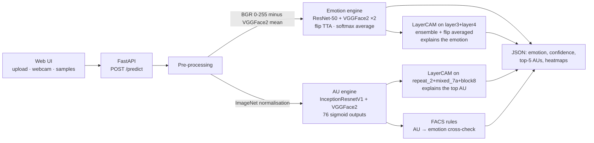

# FA&EFER — Fairness-Aware and Explainable Facial Emotion Recognition

An explainable facial emotion recognition system with two engines that share a **face-domain backbone (VGGFace2)**:

| Engine | Task | Model | Data |
|---|---|---|---|
| **Emotion engine** | 7 emotions: Surprise, Fear, Disgust, Happiness, Sadness, Anger, Neutral | ResNet-50 initialised with **VGGFace2** weights, fine-tuned (single deployed checkpoint + logit adjustment) | RAF-DB (12,271 train / 3,068 test) |
| **Action Unit (AU) engine** | 76 facial muscle movements (FACS Action Units), multi-label | InceptionResnetV1 initialised with VGGFace2 weights | RAF-AU (4,601 faces) |

Every prediction comes with a **Grad-CAM heatmap** and the **Action Units** behind it, mapped to emotions with Ekman's Facial Action Coding System (FACS). A FastAPI web app serves single-image analysis (upload or webcam) and batch PDF audit reports.

---

## Results (RAF-DB test set, 3,068 images)

Model selection uses a stratified 10% validation split of the training set; the **test set is used once**, at the end.

| Model | Test accuracy | Test macro-F1 |
|---|---|---|
| Baseline: ResNet-18 + ImageNet (Review 1) | 83.67% | - |
| ResNet-50 + VGGFace2, no fairness mitigation (emotion_r50_nofair) | 88.85% | 83.27% |
| ResNet-50 + VGGFace2, seed 7, class-weight power 0.3 (uncalibrated) | 88.82% | 82.50% |
| **Deployed: same seed-7 checkpoint + logit adjustment (tau = 0.50)** | **88.30%** | **82.23%** |

All figures in this table are produced by `fairness.py` (see `audit_results/`) on the full test set. The deployed system is a **single checkpoint** (models/emotion_r50_s7_cw03.pth) with per-class logit adjustment; it is not a multi-model ensemble. Earlier README figures (about 90% accuracy) came from older runs and are superseded by this audit.

Per-class results of the deployed model:

| | Surprise | Fear | Disgust | Happiness | Sadness | Anger | Neutral |
|---|---|---|---|---|---|---|---|
| Precision | 0.844 | 0.616 | 0.649 | 0.974 | 0.856 | 0.828 | 0.883 |
| Recall | 0.891 | 0.716 | 0.775 | 0.928 | 0.883 | 0.833 | 0.856 |
| F1 | 0.867 | 0.662 | 0.707 | 0.951 | 0.869 | 0.831 | 0.869 |
For context, published RAF-DB results with face-pretrained ResNet-50 backbones are around 89–91% (e.g. DMUE 89.42%, EAC 90.35%).

### Fairness across emotion classes

RAF-DB has no demographic labels in our setup, so `fairness.py` treats each emotion as a group and asks whether every emotion is recognised equally well (equal opportunity). From the per-class recall above: balanced accuracy 84.0% (vs 88.3% accuracy), worst class Fear 71.6% (53/74) vs best Happiness 92.8% — a recall ratio of 0.77, below the 0.80 "four-fifths" rule of thumb. The minority classes (Fear, Disgust, Anger: under 6% of training images each) average 77.5% recall vs 88.9% for the others. These numbers come from the single deployed model (`audit_results/`); `fairness_check.txt` there prints "NOT INTEGER" for three rows only because recall is rounded to 4 decimals and the check tolerance is tight — the underlying counts are whole. Class weighting, ensembling and per-class calibration are the mitigations; `fairness.py` compares them side by side.

```bash
venv\Scripts\python.exe fairness.py --data_dir TestDb/DATASET
# optional: demographic audit if you have the RAF-DB manual attribute files
venv\Scripts\python.exe fairness.py --data_dir TestDb/DATASET --attributes <RAF-DB>/basic/Annotation/manual
```

It writes `models/fairness_report.json` and `models/fairness_report.png`. The app reads the JSON at start-up.

**With vs without fairness.** `train_nofair.bat` trains a baseline with the same network, data and seed as model 1 but *no* fairness mitigation (`--class_weight_power 0 --select_metric accuracy`, no calibration) and saves `models/emotion_r50_nofair.pth`, then re-runs `fairness.py`. The audit then reports accuracy, balanced accuracy, macro-F1, worst-class recall, recall gap/ratio and per-class recall for both systems. The app runs the baseline next to the deployed model, so every prediction and every batch report also shows what the model would have said without fairness.

What the app shows:

- **Single image (`/predict`, UI card "Fairness & Reliability"):** confidence, top-2 margin, uncertainty (normalised entropy), the predicted class's test recall/precision and training share (minority flag), agreement with the FACS rule engine, a High/Medium/Low reliability band, a "needs review" flag, and the model-level audit summary.
- **Batch PDF report:** each row shows confidence, reliability and the FACS cross-check; a "Fairness & Reliability" page gives per-class recall/precision/F1 on the sample, the recall gap and ratio, how many errors were flagged for review, the FACS agreement rate, and the full test-set audit with the mitigation comparison and chart.

> **Batch PDF report vs. test accuracy.** The report samples 5 random images per emotion (35 in total), so it weights every emotion equally and varies by several points between runs (expect roughly 75–95%). Use the numbers above, not the PDF, as the model's accuracy.

---

## How it works



**Emotion engine** (`train_emotion_resnet50_vggface2.py`)
- **Backbone:** the official VGGFace2 ResNet-50 (`resnet50_ft`: pre-trained on MS1M, fine-tuned on VGGFace2), rebuilt in its original **Caffe layout** — stride-2 on the first 1×1 conv of each bottleneck and a `ceil_mode` max-pool. Loading these weights into `torchvision.models.resnet50` gives no error but wrong features.
- **Input:** RGB → **BGR, 0–255, minus mean `[91.4953, 103.8827, 131.0912]`**, the format the weights were trained with. Using ImageNet normalisation here was the main reason earlier attempts stalled at 30–40%.
- **Safety check:** training stops unless all 265 backbone tensors load (`loaded 265/265`).
- **Training:** 2 head-only warm-up epochs, then full fine-tuning; backbone LR 1e-4, head LR 1e-3, AdamW, 1-epoch warm-up + cosine schedule, label smoothing 0.1, class weights `(N / 7·n_c)^p` (p = 0.5 or 0.3), augmentation (random resized crop, flip, rotation, colour jitter, random erasing), mixed precision, early stopping on validation macro-F1.
- **Ensemble** (`ensemble_emotion.py`): averages softmax probabilities (with horizontal-flip test-time augmentation) over models, chooses the model subset and small per-class log-prior offsets on the **validation** split, and writes `models/emotion_ensemble.json`.

**AU engine** (`train_rafau.py`): multi-hot targets over 76 AU labels, `BCEWithLogitsLoss` with `pos_weight = (N − P) / P` for rare AUs, AdamW, ReduceLROnPlateau on validation macro-F1. Validation (921 faces): micro-F1 53.8%, macro-F1 17.4% — macro-F1 is low because many of the 76 labels are left/right variants with only a handful of examples.

**FACS rules** (`classify_emotion_from_aus` in `app.py`): canonicalises AU labels (L12/R12 → AU12), scores each emotion from its key AUs (e.g. Happiness = AU6 + AU12) with suppression rules for look-alikes, and returns Neutral when no score passes 0.4. Used to explain the emotion in muscle terms and as a fallback; on its own it reaches about 31% on RAF-DB, which is why the learned emotion engine makes the decision.

More detail: [`PROJECT_ARCHITECTURE_AND_WORKINGS.md`](PROJECT_ARCHITECTURE_AND_WORKINGS.md).

---

## Repository structure

```text
├── app.py                               FastAPI server: model loading, inference, FACS rules, Grad-CAM, PDF report
├── static/index.html                    Two-panel web UI
├── train_emotion_resnet50_vggface2.py   Emotion engine training (ResNet-50 + VGGFace2)
├── ensemble_emotion.py                  Validation-based ensemble + calibration → models/emotion_ensemble.json
├── fairness.py                          Fairness metrics (per class / per group) + test-set audit → models/fairness_report.json
├── train_rafau.py                       AU engine training on RAF-AU
├── train_emotion.bat                    Train emotion model 1 (Windows, uses venv)
├── train_more.bat                       Train emotion models 2 & 3 and build the ensemble
├── train_nofair.bat                     Train the baseline WITHOUT fairness and run the with-vs-without audit
├── run.bat / run.ps1                    Start the web app on http://127.0.0.1:8001
├── models/
│   ├── au_labels.json                   The 76 AU label names (head order)
│   ├── emotion_ensemble.json            Which emotion models the app combines
│   ├── emotion_r50_*.pth, best_*.pth    Trained checkpoints (Git LFS)
├── notebooks/
│   ├── FA_EFER_ResNet50_VGGFace2_Colab.ipynb   Train the emotion engine on Google Colab
│   └── FA_EFER_ResNet18_VGGFace2.ipynb         AU research notebook (EDA, AU metrics, FACS, Grad-CAM)
├── legacy/                              Earlier experiments kept for reference (ResNet-18 baseline, InceptionResnetV1 emotion model)
├── DATASETS.md                          How to obtain and lay out the datasets (not included in this repo)
├── CHANGELOG.md
└── requirements.txt
```

---

## Setup

```bash
python -m venv venv
venv\Scripts\activate                     # Linux/macOS: source venv/bin/activate
pip install torch==2.6.0 torchvision==0.21.0 --index-url https://download.pytorch.org/whl/cu124
pip install -r requirements.txt
pip install facenet-pytorch==2.6.0 --no-deps   # its declared pins conflict with torch 2.6; it works fine
```

1. **Datasets** — see [`DATASETS.md`](DATASETS.md). RAF-DB and RAF-AU are licensed for non-commercial research and **must not be redistributed**, so they are not in this repository.
2. **VGGFace2 weights** (only needed for training) — download `resnet50_ft_weight.pkl` from the "Pretrained models" table of [cydonia999/VGGFace2-pytorch](https://github.com/cydonia999/VGGFace2-pytorch) and place it in `models/`.

## Train

```bash
train_emotion.bat          # model 1  (≈ 40 min on an RTX 4060 laptop GPU)
train_more.bat             # models 2 & 3 + ensemble; re-run to resume after a crash
# extra options are passed through, e.g.  train_emotion.bat --eval_only
```

No GPU? Use [`notebooks/FA_EFER_ResNet50_VGGFace2_Colab.ipynb`](notebooks/FA_EFER_ResNet50_VGGFace2_Colab.ipynb) on Google Colab (checkpoints are saved to Google Drive every epoch).

Useful flags of `train_emotion_resnet50_vggface2.py`: `--resume`, `--eval_only`, `--seed`, `--split_seed` (keep 42 so models share a validation split), `--class_weight_power`, `--select_metric` (`macro_f1` or `accuracy`), `--batch_size`, `--no_amp`, `--no_cudnn`.

## Run the app

```bash
run.bat                    # then open http://127.0.0.1:8001
```

The start-up log should list the loaded emotion models. The app uses `models/emotion_ensemble.json` if present, otherwise `models/best_resnet50_vggface2_emotion.pth`.

| Endpoint | Purpose |
|---|---|
| `GET /` | Web UI |
| `POST /predict` | Image → `predicted_emotion`, `emotion_confidence`, `emotion_probabilities`, `emotion_grad_cam`, top-5 AUs with descriptions, AU heatmap (`grad_cam`), `fairness` (reliability and fairness context) |
| `POST /generate-report` | PDF with 5 random test images per emotion, heatmaps, AUs, a summary and a Fairness & Reliability page |
| `GET /api/samples` | One sample image per emotion from the local test folder |

---

## Limitations

- The emotion model is trained on **aligned, tightly cropped faces**; the app does not yet detect/align faces, so webcam and arbitrary photos are less accurate than the test numbers.
- Fear (74 test images) and Disgust remain the weakest classes.
- RAF-DB has no demographic labels in our setup, so fairness is assessed per class. `fairness.py --attributes` can audit gender/race/age if you obtain RAF-DB's manual attribute files; check their format against `load_rafdb_attributes()` first.
- The AU engine still uses the earlier InceptionResnetV1 backbone and ImageNet-style normalisation.

## Acknowledgements

- RAF-DB / RAF-AU — Li, Deng & Du (CVPR 2017); Yan et al. (ACCV 2020). PRIS, Beijing University of Posts and Telecommunications.
- VGGFace2 — Cao et al. (IEEE FG 2018). PyTorch conversion and ResNet-50 definition adapted from [cydonia999/VGGFace2-pytorch](https://github.com/cydonia999/VGGFace2-pytorch) (MIT licence).
- Grad-CAM — Selvaraju et al. (ICCV 2017), via [pytorch-grad-cam](https://github.com/jacobgil/pytorch-grad-cam).

Academic and research use only.
